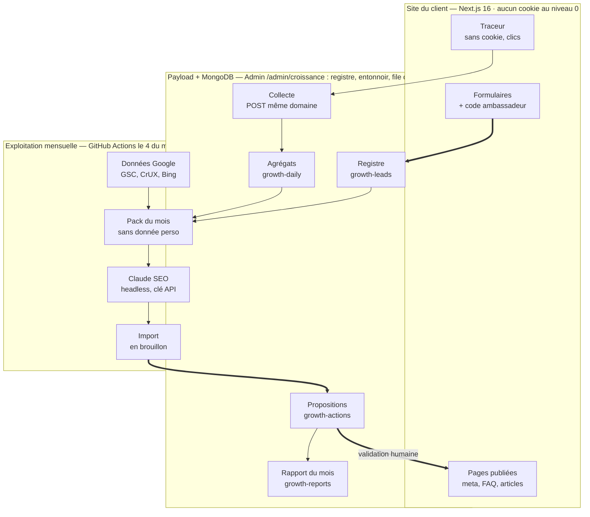

*Projet YDays · Rythme B · Tristan Gerber (porteur), Jérémy et Paul · dossier du 28 octobre 2026, mis à jour le 18 novembre 2026*

# Sillage — système de croissance

> Sillage est un SaaS qui aide les entreprises, à commencer par les agences immobilières, à comprendre leur site web et à en tirer plus de demandes. Une IA analyse les pages et les données Google pour proposer des améliorations SEO, et un suivi anonyme relie chaque demande à sa source jusqu’au mandat ou à la vente. 

1. [L’essentiel](#1-lessentiel)
2. [Les trois liens](#2-ce-que-disent-les-trois-liens)
3. [Le concept optimisé](#3-le-concept-optimisé)
4. [Architecture](#4-architecture)
5. [RGPD](#5-rgpd--le-design-conforme)
6. [SEO automatisé](#6-seo-automatisé--les-règles-du-jeu)
7. [Claude en automatique](#7-claude-en-mode-automatique)
8. [Marché et prix](#8-marché-et-prix)
9. [Cible et segmentation](#9-cible-et-segmentation)
10. [Budget et acquisition client](#10-budget-et-acquisition-client)
11. [D&P, terrain de test](#11-dp-terrain-de-test)
12. [Leviers forts](#12-leviers-forts)
13. [Organisation et planning](#13-organisation-et-planning)
14. [Feuille de route après la V1](#14-feuille-de-route-après-la-v1)
15. [Points à trancher](#15-points-à-trancher)
16. [Incertitudes](#16-ce-qui-reste-incertain)
17. [Sources](#17-sources-principales)

---

## 1. L’essentiel

### Les deux objectifs

1. **Analyser les demandes.** Pour chaque demande reçue, savoir d’où elle vient (Google, portail, recommandation, QR code, IA, réseau social) et ce qu’elle devient (qualifiée, estimation, mandat, vente, perdue).
2. **Développer les demandes.** Utiliser cette analyse pour en obtenir plus : améliorations SEO préparées par l’IA et validées par une personne, pages qui convertissent mieux, budget déplacé vers les sources qui rapportent des mandats.

### Ce qui change par rapport au récap

Huit changements, du plus structurant au plus pratique.

1. **Le cœur du produit devient le registre des demandes.** DataFast relie les ventes en ligne à leur source pour 9 à 19 $ par mois. Aucun outil, payant ou open source, ne suit une demande de contact jusqu’à l’affaire signée des semaines plus tard. La valeur est là, et c’est l’équivalent de l’API Payment de DataFast transposé aux leads.
2. **On mesure toutes les demandes, réseau compris.** Les clients de D&P arrivent surtout par recommandation. Liens et QR codes par ambassadeur, clics WhatsApp et téléphone, champ « Comment nous avez-vous connus ? » et saisie des demandes reçues hors du site comptent autant que le trafic web.
3. **Sans cookie ne veut pas dire sans consentement.** La CNIL, l’AEPD et l’EDPB traitent une empreinte IP + navigateur comme un cookie. L’exemption tient à la finalité, des statistiques anonymes. Relier un parcours à une personne en sort, d’où trois niveaux (section 5).
4. **Claude SEO tourne côté exploitation, jamais sur le site du client.** Un run mensuel sans surveillance exige une clé API, un abonnement Pro ou Max l’interdit. Les propositions arrivent en brouillon et une personne les valide, comme Google le demande pour le contenu IA dans son guide mis à jour le 1er octobre 2026.
5. **Trois paliers d’abonnement, sans part sur les ventes.** 400 € par mois ne paie pas un contenu relu par un humain. Proposé : 490, 890 et 1 500 € HT par mois, avec des livrables chiffrés.
6. **Les agences immobilières comme cible de test, puis une cible plus large.** D&P est prêt à intégrer l’outil, une demande vaut cher (un mandat vendeur rapporte environ 10 000 à 15 000 € d’honoraires, estimation) et l’entonnoir estimation → mandat → vente se mesure. Sans pourcentage sur les ventes, la loi Hoguet ne bloque plus : on vend un logiciel à des professionnels titulaires de la carte.
7. **Un SaaS qui se branche sur n’importe quel site.** La plupart des agences ont un site fourni par leur logiciel métier. Sillage s’y branche par un script ; le plugin Payload reste le connecteur le plus complet, pour D&P (section 4).
8. **Le registre et les alertes arrivent dès la première version.** Le tableau de bord n’attend plus le mois 2 ou 3. Même avec peu de trafic, une demande alertée, routée et suivie jusqu’à l’affaire se voit tout de suite.

> [!WARNING]
> **Deux alertes avant de coder**
>
> - **Le site D&P charge Google Tag Manager sans consentement.** `app/(frontend)/layout.tsx:20` l’injecte dès que `NEXT_PUBLIC_GTM_ID` existe, sans bannière, alors que la page Cookies annonce un dépôt « après votre accord ». À vérifier dans le conteneur GTM, puis à corriger avant d’ajouter quoi que ce soit.
> - **Personne n’est prévenu quand une demande arrive.** Brevo et nodemailer sont dans `package.json` mais jamais importés. Les demandes attendent dans l’admin qu’on vienne les lire. Une alerte routée vers l’agence concernée est le premier gain à livrer.

---

## 2. Ce que disent les trois liens

### DataFast · datafa.st

L’analytics de Marc Lou part du revenu. Un script d’environ 15 Ko pose quatre cookies first-party (visiteur 365 jours, session 30 minutes), suit les navigations des applications monopage, capte les UTM et les identifiants de clic (gclid, fbclid, msclkid…), puis relie chaque paiement à la visite. Le site passe l’identifiant du visiteur dans les métadonnées du paiement Stripe, LemonSqueezy ou Polar, ou l’envoie à une API Payment idempotente et rétrodatable. Autour : goals par attribut HTML, funnels, profils visiteurs, temps réel, API, CLI et serveur MCP. Prix : 9 $ (Starter) et 19 $ (Growth) par mois pour 10 000 événements.

| Chez DataFast | Chez Sillage, pour des demandes |
| --- | --- |
| L’identifiant visiteur voyage dans les métadonnées du paiement | L’attribution (page d’entrée, référent, UTM, bien, langue) voyage avec la soumission du formulaire, côté serveur |
| API Payment idempotente et rétrodatable | API « résultat d’affaire » : qualifiée, visite, offre, mandat ou vente, perdue, avec montant et date |
| KPI n°1 configurable | KPI n°1 = demande qualifiée ; toutes les vues comptent en demandes et en valeur, jamais en pages vues |
| Goals par attribut `data-fast-goal` | Goals posés par le script ou les blocs Payload : clic tel:, WhatsApp, ouverture et début de saisie du formulaire |
| Documentation en Markdown et serveur MCP | Agrégats lisibles par Claude SEO pour croiser pages, requêtes et demandes |

**Ce qu’on laisse.** L’identifiant de 365 jours et les parcours par visiteur posés sans consentement, qui sortent de l’exemption CNIL. L’hébergement : l’éditeur, JustShipIt Pte. Ltd., relève du droit de Singapour, son infrastructure est majoritairement hors UE (dont les États-Unis), OpenAI figure parmi ses sous-traitants et la durée de conservation n’est pas chiffrée. Le flou du modèle d’attribution aussi : first ou last touch n’est documenté nulle part. Le nôtre sera affiché et réglable.

**Pas de clone à partir de zéro.** Umami v3 (MIT) couvre goals, funnels, parcours, UTM, revenus et attribution. Talivia (MIT, 2 300 étoiles, 11 commits) se présente comme l’alternative open source à DataFast, avec attribution first et last touch. Les deux tournent sur Postgres. Plausible CE, Rybbit et OpenPanel sont sous AGPL : on s’en inspire sans copier une ligne. Aucun ne modélise « demande → affaire ». Recommandation : construire léger en reprenant les idées et le code MIT d’Umami et de Talivia, notices conservées.

### Claude SEO · claude-seo.md

Un ensemble de skills et d’agents pour Claude Code, sous licence MIT : 25 sous-skills et 19 agents, dont jusqu’à 17 lancés par un audit complet. Version 2.5.0 du 22 octobre 2026, environ 22 700 étoiles, trois versions par mois en septembre et octobre. Il est déjà installé sur ta machine ; son audit du 25 octobre a noté le nouveau site D&P 52 sur 100.

- **Données gratuites :** PageSpeed, CrUX, Search Console, URL Inspection, GA4 (trafic organique seulement), Bing Webmaster, IndexNow, Common Crawl. **Payantes en option :** DataForSEO, Firecrawl au-delà de 500 crédits par mois, Keyword Planner.
- **Sorties :** un dossier `{domaine}-audit/` avec `FULL-AUDIT-REPORT.md`, `ACTION-PLAN.md` priorisé et `audit-data.json`.
- **Limites pour un service mensuel :** conçu pour l’interactif (il demande des confirmations), chemins relatifs, une seule configuration Google par machine, Python et Chromium à installer, aucune lecture des conversions ni des leads, ni planification ni multi-clients, et un pied de page promotionnel imposé après chaque livrable.

Conséquence : c’est un moteur d’analyse à faire tourner côté exploitation, dans une version figée ou un fork (la licence MIT le permet), avec une consigne non interactive et un dossier par client et par mois. Sillage fournit les données de demandes et reçoit les propositions.

### Le repo du site D&P · wav-rover/dpi-front

Lu sans modification sur la branche `feat/seo-fixes` (8225f50). Ce qui compte pour le connecteur Payload :

| Constat | Où | Conséquence |
| --- | --- | --- |
| Un seul chemin pour les deux formulaires (contact et cercle privé) | `useCmsForm.ts:88` → `setData.ts:57-69` | Un branchement couvre toutes les demandes |
| Une demande ne garde que des paires nom/valeur : ni page, ni référent, ni UTM, ni bien | `FormSubmissions/index.ts:24-66` | L’attribution est à joindre à l’envoi |
| `?destination=` ne transmet que l’agence ; les pages jet et yacht renvoient vers /contact sans contexte | `properties/[slug]/page.tsx:77`, `lifestyle/[type]/page.tsx:110` | Passer le bien et le contexte au formulaire |
| formSubmissions est fermé en création et en modification | `FormSubmissions/index.ts:17-22` | Le statut d’affaire vit dans une collection à part |
| Aucune alerte e-mail | `package.json:31,70`, jamais importés | Premier gain à livrer |
| GTM chargé sans consentement | `(frontend)/layout.tsx:20` | Écart avec la page Cookies |
| Jobs Payload déclarés mais inactifs (aucune tâche) ; tout utilisateur connecté peut les lancer | `payload.config.ts:87-104` | Le plugin activera la file : resserrer l’accès |
| Nav admin maison avec emplacements `beforeNavLinks` et `afterNavLinks` | `Admin/Nav/index.tsx:20-26` | Une entrée « Croissance » sans toucher au Nav |
| Import map versionnée, jamais régénérée en CI | `(payload)/admin/importMap.js` | `generate:importmap` et commit à chaque installation |
| Brouillons et autosave sur Posts, Agencies, Properties et le global SEO | `Posts/index.ts:121-123` et suivants | La validation humaine existe déjà |

dwell-prestige.com sert bien le nouveau site (vérifié le 27 octobre). En revanche, les corrections de `feat/seo-fixes` ne sont ni dans `develop` ni dans `main`, `docs/lancement.md` est périmé, le blog est vide et le site n’existe qu’en français.

---

## 3. Le concept optimisé

La boucle du récap reste la bonne. Chaque étape repose maintenant sur une brique précise.

| Étape | Brique | Ce qu’elle apporte |
| --- | --- | --- |
| **Mesurer** | Registre des demandes et mesure exemptée | D’où viennent les demandes, réseau compris, et ce qu’elles deviennent. |
| **Analyser** | Pack du mois et Claude SEO | Search Console, CrUX, Bing et agrégats Sillage, sans donnée personnelle. |
| **Agir** | Propositions en brouillon | Validées nommément puis publiées : correctifs, meta, FAQ, contenus. |
| **Prouver** | Rapport du mois | Demandes et affaires par source, actions livrées, indicateurs SEO avancés. |

↻ Le mois suivant, on mesure l’effet des actions publiées.

### Les quatre briques

- **Registre des demandes, le cœur.** Toutes les demandes, tous canaux : formulaires, WhatsApp, téléphone, e-mail, portails, recommandations, salons. Pour chacune, une source technique (page d’entrée, référent, UTM, code ambassadeur) et une source déclarée, un statut (nouvelle, qualifiée, estimation, mandat, vente, perdue) et une valeur (honoraires estimés). Alerte en temps réel et routage vers l’agence concernée.
- **Mesure d’audience exemptée.** Pages, sources, campagnes et demandes comptées en agrégé, sans consentement. C’est une commodité ; elle sert surtout à nourrir l’analyse.
- **Boucle SEO mensuelle.** Données Google archivées chaque mois (Search Console ne garde que 16 mois), run Claude SEO ciblé, propositions en brouillon, validation, publication, mesure à M+1.
- **Rapport du mois.** Le produit que l’agence voit. Avec peu de volume, il liste les demandes une par une avec leur parcours plutôt que des pourcentages, et cumule sur 3 et 12 mois glissants.

| Récap initial | Version 2 | Pourquoi |
| --- | --- | --- |
| Clone de DataFast adapté aux leads | Registre des demandes + mesure d’audience exemptée | L’analytics se vend 9 à 19 $ ; le suivi demande → affaire n’existe nulle part |
| Suivi sans cookie par défaut | Trois niveaux : agrégé, demande sans parcours, parcours sur consentement | L’exemption tient à la finalité, pas à l’absence de cookie |
| Claude SEO analyse chaque mois | Run headless côté exploitation, clé API, budget plafonné, propositions en brouillon | Abonnement interdit pour un service ; claude-seo est interactif |
| On valide, c’est publié | Validation nominative tracée : qui, quand, part d’IA | Guide Google sur le contenu IA du 1er octobre 2026 |
| Tableau de bord aux mois 2 et 3 | Registre et alertes dès la V0 | Valeur visible tout de suite, même sans trafic |
| 400 à 900 € par mois | Trois paliers d’abonnement avec livrables chiffrés, sans part sur les ventes | 400 € ne couvre pas de contenu relu |
| Un secteur parmi quatre | Agences immobilières en test, puis toutes les entreprises dont une demande vaut cher | Un client prêt (D&P), puis un marché assez grand pour un SaaS |
| Plugin Payload seul | SaaS branché par script, plugin Payload comme connecteur avancé | Les agences ont des sites fournis par leur logiciel métier |

**Positionnement.** L’essai de Julien Bek pour Sequoia (« Services: The New Software », 5 mars 2026) oppose l’outil, qui laisse le travail au client, au pilote automatique, qui vend le travail fait ; les dépenses de services pèsent six fois celles de logiciel. Le point d’entrée le plus simple remplace un prestataire déjà payé, agence SEO ou webmaster : un changement de fournisseur plutôt qu’une réorganisation. Un rapport généré par IA ne différencie plus rien : AgencyAnalytics l’inclut à 20 $ par client et par mois, avec un accès MCP. Vendre « du SEO » non plus : le plugin SEO officiel de Payload, gratuit, est téléchargé 255 000 fois par semaine.

---

## 4. Architecture

Sillage se branche de deux façons :

| Mode                                | Pour qui                                                                   | Ce qu’il fait                                                                                         | Où vont les données                                                     |
| ----------------------------------- | -------------------------------------------------------------------------- | ----------------------------------------------------------------------------------------------------- | ----------------------------------------------------------------------- |
| **Script Sillage**                  | Toute agence, quel que soit son site (WordPress, site du logiciel métier…) | Mesure sans cookie, capture des formulaires, clics tel: et WhatsApp, liens ambassadeurs               | Base Sillage hébergée dans l’UE ; Sillage est sous-traitant de l’agence |
| **Plugin Payload `payload-growth`** | Sites Payload, à commencer par D&P                                         | Tout le script, plus l’attribution côté serveur et les propositions publiées en brouillon dans le CMS | Base du client                                                          |

Sur un site qui n’est pas sous Payload, Sillage ne publie rien lui-même : les propositions sont livrées dans le tableau de bord et le rapport, et l’agence ou son prestataire les applique. La démo YDays s’appuie sur le plugin, chez D&P.

### Le connecteur Payload

Un paquet `payload-growth` incubé dans `packages/` du repo D&P, sur le modèle d’`agency-globe`, puis publié en JavaScript compilé. Trois points d’entrée comme le template officiel : `.` (plugin serveur), `./client` (traceur, composants interactifs) et `./rsc` (vues admin). Dépendances pairs : payload ^3.92, next ^16, react ^19.



*La donnée personnelle reste dans la base du client. L’exploitation mensuelle ne reçoit que des agrégats et ne publie rien : une personne valide chaque proposition.*

| Collection | Rôle | Notes |
| --- | --- | --- |
| `growth-events` | Événements bruts | Time-series MongoDB par le driver natif ; TTL de 13 mois ; hash visiteur du jour, aucune IP stockée |
| `growth-daily` | Agrégats journaliers | Lus par le tableau de bord, gardés 25 mois au plus |
| `growth-leads` | Registre des demandes | Lien vers formSubmissions, sources technique et déclarée, canal, statut, valeur |
| `growth-ambassadors` | Apporteurs du réseau | Code, lien court `/r/{code}`, QR code |
| `growth-search` | Archives Search Console, CrUX, Bing | Mensuelles, dès le premier jour |
| `growth-actions` | Propositions SEO | Brouillon → validée → publiée → mesurée |
| `growth-reports` | Rapports mensuels | Mesurer, Analyser, Agir, Prouver |
| `growth-settings` (global) | Réglages | Niveaux RGPD, champs SEO que l’agent peut remplir par collection |

**Endpoints :** collecte publique sans cookie (contrôle d’origine, plafond de débit, réponse 204), statistiques pour les utilisateurs connectés, import des propositions protégé par un jeton, approbation réservée aux admins. **Jobs :** agrégation quotidienne, purge, collecte Search Console mensuelle, préparation du pack du mois, rapport mensuel.

### Points de branchement chez D&P

- `components/Site/useCmsForm.ts:88` : passer l’attribution, facultative, à l’action serveur.
- `utils/form/setData.ts:57-69` : l’écrire dans un groupe en lecture seule ; un hook `afterChange` crée le lead et envoie l’alerte.
- `instrumentation-client.ts`, à créer : page vue initiale, puis `onRouterTransitionStart` pour les navigations de `next-transition-router`.
- `app/(frontend)/properties/[slug]/page.tsx:77` et `lifestyle/[type]/page.tsx:110` : transmettre le bien, le jet ou le yacht au formulaire.
- `nginx/nginx.prod.conf:84` : une location dédiée à la collecte, avec `limit_req`.
- `payload.config.ts:88-95` : réserver le lancement des jobs aux admins.

### Pièges connus

- L’import map n’est jamais régénérée en production : chaque installation ou mise à jour qui ajoute un composant admin demande `payload generate:importmap` puis un commit.
- Les vues admin personnalisées sont publiques par défaut : chaque vue vérifie `req.user`.
- Les widgets du dashboard sont expérimentaux en 3.92 : passer par `beforeDashboard`.
- Le `schedule` d’une tâche ne fait que la mettre en file ; il faut un runner sur la même queue (D&P a un autoRun sur `default`).
- Sous MongoDB, une nouvelle collection ne demande pas de migration ; sous Postgres, chaque champ ajouté en demande une.
- Les formulaires de D&P sont maison : pour d’autres sites Payload, prévoir un adaptateur pour `@payloadcms/plugin-form-builder`.
- Les collections time-series refusent les mises à jour hors metaField et les index uniques : le temps d’engagement part dans un événement séparé.
- Des paquets `@payloadcms/*` de versions différentes cassent l’admin : épingler la même version exacte (D&P utilise des plages `^3.92.0`).

**Volume.** 50 000 pages vues par mois font environ 15 Mo d’événements bruts, soit 0,4 Go sur 25 mois : rien pour le VPS de 8 Go de D&P. Pour le mode script, multi-agences, une base centralisée (Postgres, ou ClickHouse au-delà de quelques centaines de sites) sera à choisir.

---

## 5. RGPD : le design conforme

La CNIL exempte de consentement la mesure d’audience limitée au site, pour le seul éditeur, qui produit des statistiques anonymes, ne recoupe aucun autre traitement et ne suit pas le visiteur ailleurs ; durée de vie du traceur 13 mois sans prolongation, conservation 25 mois. Ces règles valent pour tous les traceurs, localStorage et empreinte compris. L’EDPB (lignes directrices 2/2023, version du 7 octobre 2024) range le suivi par IP et en-têtes dans le même régime que le cookie. Le guide de l’AEPD de janvier 2024 reprend les mêmes critères et exige un contrat de sous-traitance quand un prestataire intervient.

| Niveau | Consentement | Ce qui est collecté | Ce qu’on en tire |
| --- | --- | --- | --- |
| **0 · Mesure exemptée** (par défaut) | ✅ Non | Pages, référents, UTM, appareil, pays ; demandes comptées par page et par source ; ni IP ni navigateur bruts ; 13 et 25 mois | Quelles pages et quelles sources amènent des demandes, en agrégé |
| **1 · Demande** | ✅ Non (la demande elle-même, art. 6.1.b ; suivi commercial, art. 6.1.f) | Ce que le visiteur envoie, page et bien d’envoi, langue, source déclarée, code ambassadeur visible dans le formulaire | Source déclarée → demande → affaire, dans le registre |
| **2 · Parcours complet** | ⚠️ Oui, finalité séparée, Accepter et Refuser au même niveau | Premier et dernier contact, pages vues, nombre de visites ; stockage de 13 mois au plus | Attribution sur plusieurs visites pour chaque demande |

- **Zone grise à faire trancher :** joindre sans consentement les UTM et le référent de la session à une demande. Piste prudente, à valider : le code ambassadeur pré-rempli dans un champ visible et modifiable (« Recommandé par »), que le visiteur envoie lui-même.
- **Mentions :** dans la politique de confidentialité et la page Cookies de chaque agence, une section « mesure d’audience exemptée » ; sous chaque formulaire, l’information de l’article 13 ; une bannière seulement si le niveau 2 est activé.
- **Contrats :** un contrat de sous-traitance (art. 28) entre chaque agence, responsable du traitement, et Sillage. En mode script, Sillage héberge les données : hébergement dans l’UE obligatoire.
- **Claude :** le modèle ne reçoit que des agrégats anonymes, jamais une donnée de demande.
- **Calendrier :** le Digital Omnibus (futur article 88a du RGPD) pourrait assouplir la mesure d’audience, pas avant 2027 ou 2028.

Coût de lancement à prévoir : une relecture par un avocat ou un DPO avant de vendre la promesse « sans bannière ».

---

## 6. SEO automatisé : les règles du jeu

Google accepte le contenu produit avec l’IA et sanctionne la production en volume sans valeur ajoutée, quelle que soit la méthode (« scaled content abuse », depuis mars 2024). Son guide sur le contenu IA, mis à jour le 1er octobre 2026, demande une vérification humaine avant publication, titres, meta descriptions, données structurées et textes alternatifs compris. Pour des agences présentes sur plusieurs villes, le risque le plus direct est celui des pages ville par ville quasi identiques (« doorway »), puis des traductions automatiques non relues.

| ✅ Sûr | ⛔ À bloquer dans l’outil |
| --- | --- |
| Correctifs techniques, titres, meta, maillage interne, schema conforme au texte visible | Pages ville × service générées en lot |
| Enrichir les pages existantes avec l’expertise de l’agence : biens réels, données de marché maison | Traductions automatiques publiées sans relecture |
| FAQ tirées des vraies questions reçues par les formulaires | Articles génériques sans information propre |
| Traductions relues par quelqu’un qui parle la langue | Contenus de tiers hébergés pour profiter de la réputation du site, domaines expirés |

**Règle maison.** Sur un petit site, au plus 2 à 4 nouvelles pages de fond par mois, au moins 2 pages existantes améliorées pour 1 nouvelle, et une trace de chaque validation : qui, quand, part d’IA.

**Attentes réalistes.** Quand un résumé IA s’affiche, 8 % des recherches mènent à un clic sur un résultat, contre 15 % sans (Pew, juillet 2025). Google a déployé 2 mises à jour majeures et 4 mises à jour anti-spam en 2026 : le rapport place ces dates sur la courbe et promet des demandes attribuées, jamais du trafic. Côté IA, Google n’utilise pas llms.txt et ne demande aucun balisage spécial ; ChatGPT search dépend du robot OAI-SearchBot ; les demandes venues de chatgpt.com, perplexity.ai ou gemini forment un canal « IA » dans le registre.

### Données par client, toutes gratuites

| Source | Usage | Limites |
| --- | --- | --- |
| Search Console | Requêtes, pages, pays, appareils | 16 mois d’historique, d’où l’archivage dès le premier jour ; 25 000 lignes par appel |
| URL Inspection | Indexation de chaque URL du sitemap | 2 000 par jour et par site |
| CrUX et PageSpeed | Core Web Vitals | Une clé API ; pas de données de terrain si le trafic est trop faible |
| Bing Webmaster et IndexNow | Requêtes Bing, soumission des pages publiées | IndexNow ne sert pas Google |
| Google Business Profile | Appels, itinéraires et clics depuis les fiches | Accès sur demande, fiche vérifiée depuis plus de 60 jours ; essentiel pour le SEO local d’une agence |
| Indexing API | ⛔ À exclure | Réservée aux offres d’emploi et aux vidéos en direct |

Embarquer une agence : elle vérifie une propriété Domaine dans Search Console et y ajoute notre compte de service en accès restreint ; le site est importé dans Bing Webmaster ; la clé IndexNow est servie par le site.

---

## 7. Claude en mode automatique

**Conditions.** Les abonnements Free, Pro et Max relèvent des conditions grand public, qui interdisent l’usage commercial et l’accès automatisé sauf par clé API. Un service mensuel pour des clients passe donc par une clé de la Claude Console, au nom de la société, sous les conditions commerciales ; l’Agent SDK y est soumis aussi.

**Architecture v1.** Un dépôt privé `growth-ops` avec un workflow GitHub Actions planifié le 4 du mois et une matrice de clients. Pour chaque client, des scripts sans IA extraient d’abord Search Console, CrUX, Bing et les agrégats Sillage. L’agent tourne ensuite dans un conteneur jetable :

```bash
claude --bare -p "/seo-mensuel dp" \
  --plugin-dir ./claude-seo \
  --permission-mode dontAsk \
  --allowedTools "Read,Write,WebFetch,Bash(python scripts/*)" \
  --max-budget-usd 20 \
  --output-format json
```

L’agent ne publie jamais : il dépose ses propositions avec une clé limitée aux propositions (`growth-actions`). Le contenu des pages crawlées n’est pas fiable (injection de consignes) : pas de Bash libre, aucun secret client inutile dans l’environnement, durée du job plafonnée.

**Coût.** Tarifs Anthropic relevés le 27 octobre 2026 : Sonnet 5.5 à 2 $ en entrée et 10 $ en sortie par million de tokens, Opus 5.5 à 4 $ et 20 $. Un run ciblé sur Sonnet coûte environ 3 à 4 $, un audit complet d’une quinzaine d’agents environ 9 à 15 $ (estimation, à mesurer avec `total_cost_usd` lors du pilote). Moins de 4 % d’un abonnement de 490 €. Le vrai coût est le temps de validation humaine.

**Ensuite.** Quand Sillage devra lancer et suivre les runs lui-même, passer à l’Agent SDK TypeScript. Les déploiements planifiés de Managed Agents, exécutés chez Anthropic, sont une autre piste à évaluer face aux besoins Python et Chromium de Claude SEO.

---

## 8. Marché et prix

| Outil | Ce qu’il fait | Prix public |
| --- | --- | ---: |
| **DataFast** | Analytics et attribution des revenus en ligne | 9–19 $/mois |
| **Attributer.io** | Attribution écrite dans les champs cachés du formulaire | 29–99 $/mois |
| **WhatConverts** | Formulaires, appels, chat ; parcours multi-touch seulement en Elite | 30–160 $/mois |
| **CallRail** | Suivi d’appels et de formulaires | 50–195 $/mois |
| **Ruler Analytics** | Boucle fermée jusqu’au chiffre d’affaires, six modèles | 309–1 739 €/mois |
| **AgencyAnalytics** | Reporting d’agence, résumés IA, accès MCP | 20 $/client/mois |

Le marché se range en trois étages : capture d’attribution sur formulaire (30 à 200 $ par mois), boucle fermée jusqu’au chiffre d’affaires (300 € et plus), reporting d’agence (environ 20 $ par client). L’analytics justifie au plus 100 à 150 € de valeur dans l’abonnement ; le reste vient du SEO piloté, du travail humain et de la preuve par les affaires.

- **Site vitrine :** médiane agence 3 500 €, médiane freelance 1 450 € (baromètre Les Créavores, 103 prix publics, juin 2026).
- **Abonnement SEO d’agence pour une PME :** le plus souvent 800 à 2 000 € HT par mois (La Fabrique du Net, chiffres lus dans des extraits) ; médiane européenne de 841 $ (SE Ranking, 2023).
- **Maintenance seule :** 60 à 350 € HT par mois. **Engagement :** 6 à 12 mois est l’usage.

### Trois paliers d’abonnement

Abonnement seul, sans aucun pourcentage sur les ventes. La création d’un site est une option, pour les agences qui veulent quitter le site de leur logiciel métier.

#### Mesurer — 490 € HT / mois *(Entrée)*

Site en option : 3 000 à 4 000 €

- Registre des demandes et alertes
- Mesure d’audience exemptée
- Audit technique mensuel, jusqu’à 5 correctifs proposés
- Rapport d’une page, sans rédaction
- Hébergement et maintenance si le site est fait par Sillage

#### Croissance — 890 € HT / mois *(Le cœur de l’offre)*

Site en option : 4 500 à 6 000 €

- Tout Mesurer
- Analyse Claude SEO avec Search Console et Google Business Profile
- 2 contenus par mois relus et validés
- Suivi demande → mandat → vente avec valeur
- Rapport complet et appel de 30 minutes

#### Premium multi-marchés — 1 500 € HT / mois *(Multilingue, luxe)*

Site en option : 6 000 à 12 000 € · engagement 12 mois

- Tout Croissance
- FR, EN et ES avec hreflang
- 4 contenus par mois
- SEO local multi-villes, suivi dans les réponses IA
- Revue trimestrielle ; le palier naturel de D&P

Engagement de 6 mois puis mensuel avec 1 mois de préavis. Les garanties portent sur les livrables (correctifs, contenus, date du rapport), jamais sur les positions. À vérifier : un professionnel de 5 salariés au plus qui signe hors établissement un contrat étranger à son activité principale peut disposer de 14 jours de rétractation (art. L221-3 du Code de la consommation) ; c’est le cas de beaucoup d’agences indépendantes.

### Le plugin Payload

Payload pèse lourd (environ 1 million de téléchargements npm par semaine, 45 500 étoiles, racheté par Figma en juin 2025) mais n’a pas de marketplace. Les plugins se trouvent par le topic GitHub `payload-plugin` : 323 paquets, presque tous gratuits sous MIT. Le seul plugin payant repéré, Page Composer, se vend 99 $ par domaine.

Modèle recommandé : le plugin `payload-growth` gratuit sur npm, comme porte d’entrée pour les sites Payload, et le service Sillage payant par abonnement (boucle SEO, données Google, rapport, historique). C’est un canal secondaire, à ouvrir une fois le service prouvé.

---

## 9. Cible et segmentation

**En deux temps : les agences immobilières pour tester, puis une cible plus large.**

### Cible de test : les agences immobilières

Pourquoi l’immobilier :

- **Un client prêt à intégrer l’outil.** D&P est d’accord, son site est en production et le code est maîtrisé.
- **Une demande vaut cher.** Un mandat vendeur rapporte environ 10 000 à 15 000 € d’honoraires (estimation) : savoir d’où viennent ses mandats justifie un abonnement de quelques centaines d’euros.
- **Un entonnoir mesurable.** Demande → estimation → mandat → vente, avec des dates et des montants.
- **Plus de verrou juridique.** La première analyse préférait la rénovation haut de gamme parce qu’elle permettait une rémunération au résultat. Sans pourcentage sur les ventes, cet avantage disparaît : on vend un logiciel à des professionnels titulaires de la carte, et on ne touche rien sur leurs transactions (à confirmer par un juriste).

### Local ou national ?

**On vend partout en France, on optimise en local.** La vente, l’installation et le suivi se font à distance (SaaS, script, appel mensuel) : rien n’oblige à se limiter à une ville. Mais le SEO de chaque agence reste local : ville, quartiers, fiche Google Business Profile, biens réels. Le produit doit donc gérer le SEO local agence par agence, et la prospection peut partir d’une région test avant d’aller partout.

### Segments

| Segment | Décideur | Besoin principal | Contrainte | Palier | Priorité |
| --- | --- | --- | --- | --- | --- |
| **Agences haut de gamme et internationales** (type D&P) | Dirigeant | Clientèle étrangère, recommandations, plusieurs langues | Peu de volume, mots clés disputés | Premium | 1 · cas D&P |
| **Agences indépendantes** (1 à 3 agences) | Gérant | Mandats vendeurs, visibilité locale face aux portails | Site souvent fourni par le logiciel métier | Mesurer ou Croissance | 1 · cycle de vente court |
| **Agences franchisées d’un réseau** (Orpi, Century 21, Laforêt…) | Gérant, sous les règles du réseau | Se démarquer des autres agences du même réseau | Site et charte imposés par le réseau ; script à faire accepter | Mesurer | 2 |
| **Réseaux de mandataires** (IAD, SAFTI, Capifrance…) | Agent indépendant | Leads personnels | Pas d’agence ni de site propre | — | Hors V1 |
| **Sièges de réseaux nationaux** | Direction marketing | Pilotage de centaines d’agences | Vente longue, appels d’offres | — | Après des cas chiffrés |

**Ordre recommandé :** D&P, puis 3 à 5 agences indépendantes en pilote, puis les franchisés. Les sièges de réseaux viennent quand on peut montrer des résultats sur plusieurs agences.

### Ensuite : une cible plus large

Sillage ne dépend ni de Payload ni de l’immobilier : le script se branche sur n’importe quel site. La cible large, ce sont les entreprises dont une demande de contact vaut cher et devient une affaire plus tard, hors du site. Par exemple :

- rénovation et artisans haut de gamme ;
- services premium (conciergerie, location de luxe) ;
- services B2B (cabinets de conseil, ESN, organismes de formation).

Le point commun : l’entonnoir demande → devis ou rendez-vous → affaire signée, que Sillage mesure. Avec un abonnement seul, les secteurs réglementés (avocats, santé) ne sont plus exclus pour des raisons de rémunération, mais restent à vérifier (secret professionnel, données de santé, règles de publicité). On bascule quand le cas D&P et les pilotes immobiliers sont chiffrés.

---

## 10. Budget et acquisition client

### Budget de lancement (pendant les YDays)

Estimations, à confirmer avec les factures réelles.

| Poste | Estimation | Note |
| --- | --- | --- |
| API Claude (développement et runs de test) | 20 à 50 €/mois | Run ciblé 3 à 4 $, audit complet 9 à 15 $ (section 7) |
| Hébergement du pilote | 0 € | VPS de D&P, déjà payé |
| Hébergement du SaaS (mode script) | 10 à 30 €/mois | VPS dans l’UE, à partir des premières agences hors D&P |
| Nom de domaine | 10 à 20 €/an | |
| APIs Google, Bing, IndexNow | 0 € | Gratuites |
| Outils (GitHub, Figma, e-mail transactionnel) | 0 € | Offres gratuites ou étudiantes |
| Relecture juridique RGPD (avocat ou DPO) | Devis à demander | Le seul poste important ; avant de vendre « sans bannière » |

**Total hors juridique : moins de 100 € par mois.** Le coût principal est le temps de l’équipe.

### Coût de livraison par client

Pour une agence au palier Croissance (890 €/mois) : 5 à 15 $ d’IA par mois, quelques euros d’hébergement, et surtout le temps humain (relecture des 2 contenus, validation des propositions, appel mensuel). Le temps de validation est l’indicateur à mesurer pendant le pilote : c’est lui qui fixe la marge.

### Acquérir des agences

| Canal | Coût | Rôle |
| --- | --- | --- |
| **Cas D&P chiffré** | 0 € | La preuve centrale de tout le reste |
| **Prospection directe** (LinkedIn, e-mail, téléphone) auprès de gérants d’agences indépendantes | Temps | Premier canal, dans une région test |
| **Audit gratuit du site** (Claude SEO + premières sources de demandes) | 3 à 15 $ par audit | Porte d’entrée : on montre un problème réel avant de vendre |
| **SEO de Sillage lui-même** (contenus pour agences immobilières) | Temps | Le produit appliqué à nous-mêmes |
| **Salons de l’immobilier** (par exemple RENT à Paris) | Entrée visiteur | Rencontrer gérants et éditeurs de logiciels métier, sans stand au début |
| **Partenariats** avec des webmasters d’agences et des éditeurs de logiciels métier | Part de l’abonnement reversée, à négocier | Plus tard, pour passer à l’échelle |

**Règle de budget :** une agence acquise doit coûter moins de 3 mois de son abonnement, soit au plus 1 500 € environ au palier Mesurer. On ne paie de publicité qu’une fois ce coût mesuré sur les premiers clients.

### Ce que Sillage vend : l’optimisation de l’acquisition des agences

Une agence paie déjà pour trouver des vendeurs et des acheteurs : portails, annuaires, publicité, prospection. Elle sait rarement quelle source lui rapporte ses mandats. Le rapport Sillage montre, pour chaque source, le nombre de demandes, de mandats et de ventes, et leur valeur. L’agence peut alors déplacer son budget vers ce qui marche. C’est le service d’optimisation de l’acquisition, et c’est ce qui justifie le prix face à un simple outil de statistiques.

---

## 11. D&P, terrain de test

Le choix tient : le code est maîtrisé, un seul branchement couvre toutes les demandes, les brouillons existent et le client est d’accord. Les faiblesses du récap se confirment (réseau, peu de trafic, mots clés disputés) et la recherche en ajoute trois : un site seulement en français pour une clientèle internationale, un blog vide et des corrections SEO absentes de la production. Aucune source primaire ne chiffre la part du réseau dans le luxe ; des résumés du rapport NAR 2025, non vérifiés, indiquent que l’acheteur trouve souvent son bien en ligne mais son agent par recommandation.

### Ce qu’on mesure chez D&P, mois 1 à 6

- La part des demandes qui ont une source, déclarée ou technique. Objectif : 100 %.
- Le délai entre la demande et le premier contact.
- Le pipeline par source (qualifiées, visites, offres, mandats ou ventes, valeur), en cumul glissant sur 3 et 12 mois, sans aucun taux sous 10 demandes.
- Les indicateurs SEO avancés : pages indexées, impressions sur les grappes longue traîne (FR, puis EN et ES), recherches de la marque « Dwell & Prestige ».
- Le coût réel de livraison : tokens et heures de validation.

### Prérequis, phase 0

1. Fusionner et déployer `feat/seo-fixes`, sinon la mesure du mois 0 part d’un site non corrigé.
2. Retirer GTM ou le placer derrière une vraie bannière, puis réécrire la page Cookies.
3. Créer la propriété Search Console Domaine et Bing Webmaster, soumettre les sitemaps, lancer l’archivage.
4. Envoyer une alerte e-mail pour chaque demande, routée vers l’agence concernée.
5. Décider de l’anglais et de l’espagnol : la boucle de contenu en dépend, et localiser après coup coûte une migration.
6. Faire relire l’architecture RGPD par un avocat ou un DPO.
7. Réserver aux admins le lancement des jobs Payload.

---

## 12. Leviers forts

1. **Le seul outil qui suit une demande jusqu’au mandat.** Les autres comptent des pages vues ou des formulaires ; Sillage montre combien de mandats et de ventes chaque source a rapportés.
2. **Une preuve réelle dès le départ.** D&P est d’accord, son site est en production et l’équipe en maîtrise le code.
3. **L’IA fait le travail, une personne valide.** Conforme aux règles de Google, et l’IA coûte moins de 4 % de l’abonnement.
4. **RGPD intégré.** Mesure sans bannière au niveau 0, données dans l’UE, Claude ne voit jamais une donnée personnelle (à faire valider par un juriste).
5. **Un marché national, un SEO local.** Vente à distance dans toute la France, optimisation ville par ville pour chaque agence.
6. **Un abonnement simple.** Pas de pourcentage sur les ventes, des livrables chiffrés, un rapport chaque mois.
7. **Une feuille de route claire.** Cible plus large en V2, réseaux sociaux en V3.

---

## 13. Organisation et planning

### L’équipe

Trois développeurs. Chacun porte un domaine technique et une responsabilité transverse. Répartition proposée, à confirmer en équipe.

| Personne | Domaine technique | Responsabilité transverse |
| --- | --- | --- |
| **Tristan Gerber** · porteur de projet | Tableau de bord et rapport mensuel (front, maquettes) | Business model, relation avec D&P (Rodrigue), pitch, suivi YDays |
| **Jérémy** | Suivi et registre : script, plugin Payload, collecte, formulaires, alertes | RGPD technique, mise en production chez D&P |
| **Dev 3** (nom à compléter) | IA et SEO : pipeline `growth-ops`, APIs Google et Bing, Claude SEO, propositions | Coût et budget (IA, hébergement), tests |

### Planning des 11 séances

| Séance | Objectif | Tristan | Jérémy | Dev 3 | Sortie |
| --- | --- | --- | --- | --- | --- |
| **1** | Étude de marché et business model | Segmentation, prix, budget | Analyse du repo D&P | Analyse de Claude SEO et des APIs | Ce dossier |
| **2** | Spécifications fonctionnelles et techniques | Parcours utilisateur, contenu du rapport | Modèle de données du registre, specs du script et du plugin | Specs du pipeline IA et du pack du mois | Specs validées |
| **3** | Charte graphique et maquettes | Maquettes du tableau de bord et du rapport | Phase 0 D&P : `feat/seo-fixes`, GTM, alertes e-mail | Search Console, Bing, archivage, accès APIs | Maquettes ; D&P prêt à mesurer |
| **4** | Développement, phase 1 | Squelette du tableau de bord | Registre des demandes et alertes routées | Extraction Google et pack du mois | Toutes les demandes D&P enregistrées |
| **5** | Développement, phase 2 | Vue registre et entonnoir | Mesure sans cookie, attribution jointe aux formulaires | Premier run Claude SEO sans surveillance | Sources visibles ; premier coût de run |
| **6** | Développement, finalisation | Vue file de validation | Liens et QR ambassadeurs, clics tel: et WhatsApp | Import des propositions en brouillon, validation | Boucle complète de bout en bout |
| **7** | Tableau de bord | Intégration des vues KPI | Données et performances du tableau de bord | Indicateurs SEO dans le tableau de bord | **Livrable : Dashboard KPI** |
| **8** | Rapports mensuels | Mise en page du rapport | Données demandes et affaires par source | Données SEO et actions livrées | Premier rapport envoyé à D&P |
| **9** | Tests et debug | Tests utilisateurs avec Rodrigue | Tests RGPD et charge de la collecte | Tests du pipeline, coût mesuré | Liste de bugs fermée |
| **10** | Démo visuelle et pitch deck | Pitch deck et discours | Démo en direct sur D&P | Chiffres de la démo (coûts, résultats) | **Livrable : démo visuelle** |
| **11** | Bilan et présentation finale | Présentation | Bilan technique | Bilan coûts et suite | Présentation finale |

Entre les séances : une revue de 30 minutes chaque semaine, un tableau de tâches partagé, et chaque fonctionnalité relue par un autre développeur avant d’être fusionnée.

### Après les YDays

- 3 à 5 entretiens avec des gérants d’agences indépendantes (panier moyen, sources payées, logiciel métier utilisé).
- 2 ou 3 pilotes payants, d’abord dans une région test.
- Marge calculée pour 10 agences, avec le temps de validation réel.

---

## 14. Feuille de route après la V1

**V1 (YDays) :** registre des demandes, mesure sans cookie, boucle SEO mensuelle, tableau de bord et rapport, chez D&P.

**V2 :** mode script pour tous les sites, ouverture à la cible plus large (section 9).

**V3 :** analyse des réseaux sociaux, pour toucher une cible plus communautaire.

---

## 15. Points à trancher

| Question | Décision ou recommandation | Statut |
| --- | --- | --- |
| **Cible** | Agences immobilières en test, puis cible plus large | ✅ Tranché |
| **Rémunération** | Abonnement seul, aucun pourcentage sur les ventes | ✅ Tranché |
| **Réseaux sociaux** | V3 | ✅ Tranché |
| **Mode de branchement en V1** | Plugin Payload chez D&P pour la démo ; script pour les agences ensuite | À confirmer |
| **Segment après D&P** | Agences indépendantes (cycle court), avant les franchisés | À confirmer |
| **Répartition des rôles** | Tableau de la section 13 | À confirmer en équipe |
| **Niveau RGPD par défaut** | Niveaux 0 et 1 sans bannière, niveau 2 sur consentement ; avis juridique avant de vendre | À valider par un juriste |
| **Prix** | 490, 890 et 1 500 € HT par mois, à tester pendant les pilotes | À tester |
| **Analytics** | Construire léger avec les idées et le code MIT d’Umami et de Talivia | Recommandé |
| **Exécution de Claude** | Clé API de la Console au nom de la société, budget plafonné par run | Seule option conforme |
| **Langues de D&P** | Décider l’anglais et l’espagnol avant la boucle de contenu | À décider avec D&P |

---

## 16. Ce qui reste incertain

- Le nombre d’agences immobilières en France et la part d’indépendantes (à chiffrer avec des sources : FNAIM, INSEE).
- Ce que les agences paient déjà en portails et annuaires chaque mois (à demander pendant les entretiens).
- La capacité du script à capter les formulaires des sites fournis par les logiciels métier (formulaires intégrés en iframe, accès au code du site).
- Le modèle d’attribution réel de DataFast, documenté nulle part.
- La position de la CNIL sur les UTM de session joints à une demande sans consentement.
- La configuration du conteneur GTM de production : consentement géré dedans ou non.
- Le pays d’hébergement du VPS de D&P ; hors UE, il faut encadrer les transferts.
- Les chiffres NAR sur l’origine des leads (rapport payant, résumés contradictoires) ; aucune donnée primaire sur le luxe.
- Le coût réel d’un run Claude SEO sur D&P et le temps de validation humaine par mois.

---

## 17. Sources principales

### DataFast et open source

- [Documentation DataFast](https://datafa.st/docs)
- [DataFast, mode sans cookie](https://datafa.st/docs/gdpr-cookieless-tracking)
- [DataFast, accord de traitement](https://datafa.st/dpa)
- [Talivia sur GitHub](https://github.com/talivia-group/talivia)
- [Umami sur GitHub](https://github.com/umami-software/umami)

### Claude SEO et Claude

- [claude-seo sur GitHub](https://github.com/AgriciDaniel/claude-seo)
- [Claude Code, conditions et usage](https://code.claude.com/docs/en/legal-and-compliance)
- [Claude Code en mode headless](https://code.claude.com/docs/en/headless)
- [Conditions grand public d’Anthropic](https://www.anthropic.com/legal/consumer-terms)
- [Tarifs de l’API Claude](https://platform.claude.com/docs/en/about-claude/pricing)

### Payload

- [Écrire un plugin](https://payloadcms.com/docs/plugins/build-your-own)
- [Planifier des jobs](https://payloadcms.com/docs/jobs-queue/schedules)
- [Vues admin personnalisées](https://payloadcms.com/docs/custom-components/custom-views)
- [Payload rejoint Figma](https://www.figma.com/blog/payload-joins-figma/)

### RGPD

- [CNIL, mesure d’audience exemptée](https://www.cnil.fr/fr/cookies-et-autres-traceurs/regles/cookies-solutions-pour-les-outils-de-mesure-daudience)
- [Délibération CNIL 2020-091](https://www.legifrance.gouv.fr/jorf/id/JORFTEXT000042388179)
- [EDPB, lignes directrices 2/2023](https://www.edpb.europa.eu/system/files/2024-10/edpb_guidelines_202302_technical_scope_art_53_eprivacydirective_v2_en_0.pdf)
- [AEPD, guide mesure d’audience](https://www.aepd.es/guias/guia-cookies-analiticas-externas.pdf)

### Google

- [Règles anti-spam](https://developers.google.com/search/docs/essentials/spam-policies)
- [Contenu généré par IA](https://developers.google.com/search/docs/fundamentals/using-gen-ai-content)
- [AI Overviews et AI Mode](https://developers.google.com/search/docs/appearance/ai-features)
- [Quotas de l’API Search Console](https://developers.google.com/webmaster-tools/limits)
- [Indexing API](https://developers.google.com/search/apis/indexing-api/v3/using-api)
- [Pew Research, résumés IA et clics](https://www.pewresearch.org/short-reads/2025/07/22/google-users-are-less-likely-to-click-on-links-when-an-ai-summary-appears-in-the-results/)

### Marché et prix

- [Sequoia, Services: The New Software](https://sequoiacap.com/article/services-the-new-software/)
- [Bessemer, AI pricing playbook](https://bvp.com/atlas/the-ai-pricing-and-monetization-playbook)
- [WhatConverts](https://www.whatconverts.com/pricing/) · [CallRail](https://www.callrail.com/pricing) · [Ruler](https://www.ruleranalytics.com/pricing/) · [Attributer](https://attributer.io/pricing) · [AgencyAnalytics](https://agencyanalytics.com/pricing)
- [Baromètre Les Créavores](https://dev.to/tresor4k/i-scraped-103-public-prices-to-build-an-open-dataset-of-website-creation-costs-in-france-cc-by-1d13)
- [SE Ranking, tarifs SEO](https://seranking.com/fr/blog/tarifs-seo/)

### Droit

- [Loi Hoguet](https://www.legifrance.gouv.fr/loda/id/JORFTEXT000000512228)

### Technique

- [Plausible, comptage sans cookie](https://plausible.io/data-policy)
- [MongoDB, limites des time-series](https://www.mongodb.com/docs/manual/core/timeseries/timeseries-limitations/)
- [Next.js, instrumentation-client](https://nextjs.org/docs/app/api-reference/file-conventions/instrumentation-client)

---

*Préparé le 28 octobre 2026 à partir de 23 recherches et de 29 vérifications indépendantes des affirmations dont dépend une décision, mis à jour le 18 novembre 2026 après le retour du jury. Code lu sans modification dans wav-rover/dpi-front, branche feat/seo-fixes (8225f50). Les estimations et suppositions sont signalées comme telles. Ce dossier n’est pas un avis juridique.*
